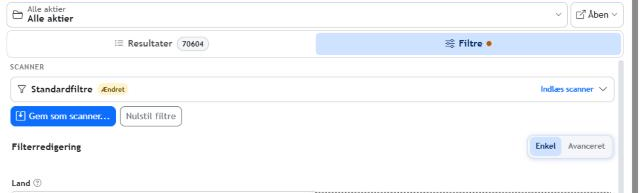
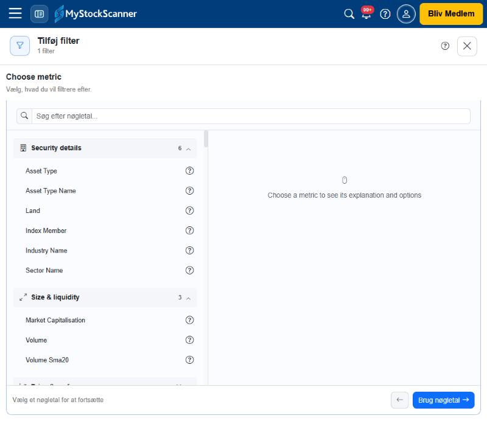
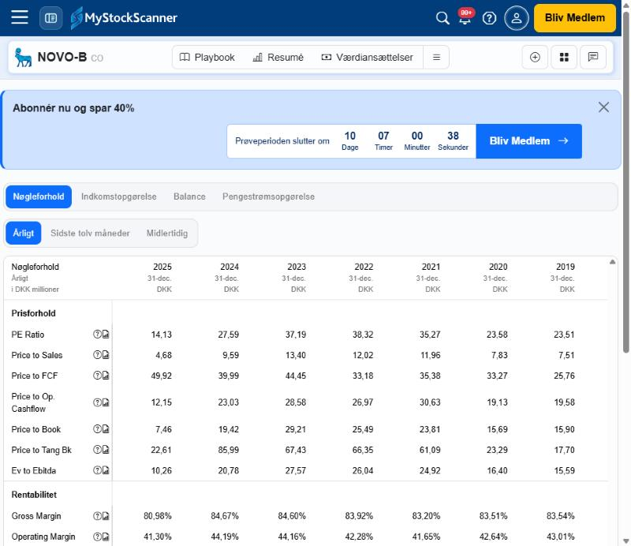
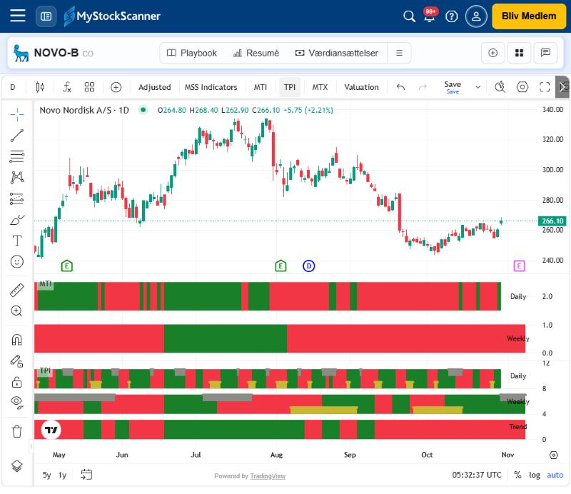
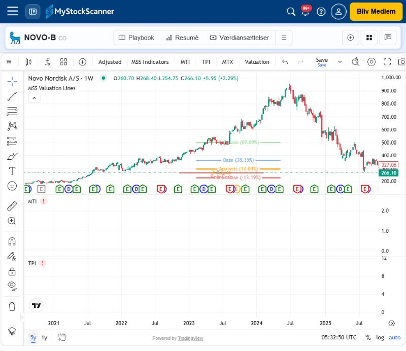

# MyStockScanner – katalog over tilgængelige data

Dato: 2. november 2026. Indlogget konto med prøveperiode (10 dage tilbage). Seneste markedsdag i data: 30. oktober 2026.

Dokumentet beskriver, **hvilke data appen viser og lader en filtrere på**, og hvor de findes. Det bygger på direkte aflæsning i brugerfladen: Udforskerens nøgletalskatalog, aktiesidens faner, TradingView-grafen og listevisningerne. Det er ikke en beskrivelse af leverandørernes rådata, og tallene er ikke uafhængigt kontrolleret. Skærmbilleder ligger i `screenshots-2026-11-02/`.

## 1. Univers og dækning

| Udsnit | Antal værdipapirer | Kilde |
|---|---:|---|
| Alle aktier, ingen filtre | 70.604 | Udforsker → Alle aktier |
| Danmark | 407 | Landefilter |
| Norge | 375 | Landefilter |
| Sverige | 1.061 | Landefilter |
| Tyskland | 4.400 | Landefilter |
| Det Forenede Kongerige | 7.319 | Landefilter (standardvalg for kontoen) |
| USA | 12.546 | Landefilter |
| Aktier i bevægelse (aktiekort) | 857 | Tidligere test T41 |

Tallene dækker **alle instrumenttyper** (aktier, ETF'er, certifikater m.m.), ikke kun almindelige aktier. Det er ikke fastlagt, om "Land" betyder selskabets hjemland eller børsens land. HY9H (koreansk selskab, Frankfurt-notering) tyder på, at noteringer i flere lande tælles hver for sig.

**Instrumenttyper** (feltet Asset Type, 16 værdier): Certificate, Commodity, CommonStock, ETF, Fund, Futures, Index, Money, Note, Obligationer, Preferred, Rate, UnitTrust, Valuta, Virtual Security, Warrant. Brancher og sektorer er selv "værdipapirer" af typen Virtual Security. Biotechnology har fx ID 2644056 og Health Care ID 2644055, så de har egne resumésider og kan sammenlignes på aktiekortet.

**Lande:** Landefilteret viser en fuld ISO-landeliste (cirka 245 lande). Kontoen har seks favoritlande med stjerne: Danmark, Det Forenede Kongerige, Norge, Sverige, Tyskland og USA. Landelisten viser ikke, at der findes data for alle lande.

**Valuta:** Markedsværdifilteret og visningerne bruger en valgbar filtervaluta. Over 150 ISO-koder findes, også GBX og ZAC (pence/cent) samt metaller (XAU, XAG, XPT, XPD). Kontoen står på **GBP**, og "Alle aktier" starter med landefilter **GB**. Det forklarer, hvorfor markedsværdier vises i GBP (se funktionstest F04). Hvorfor kontoen står på GB/GBP, er ikke afklaret. En mulig forklaring er, at kontoen mangler et land (restlisten afsnit 3).

## 2. Nøgletalskataloget i Udforskeren – 173 felter

Udforsker → Filtre → **Tilføj andre filtre** åbner kataloget "Choose metric" med 12 grupper. Alle felter kan bruges som filter. Felterne er de samme som datagrundlaget for tabelkolonner og egne layouts (op til 40 datakolonner pr. layout), men det er kun stikprøvekontrolleret, at listerne er helt ens.

| Gruppe | Antal | Felter |
|---|---:|---|
| Security details | 6 | Asset Type, Asset Type Name, Land, Index Member, Industry Name, Sector Name |
| Size & liquidity | 3 | Market Capitalisation, Volume, Volume Sma20 |
| Price & performance | 14 | 52w High, 52w Low, ChangePercent1d, Close, Close − 1m/3m/6m/1y, Close Yesterday, Performance 1m/3m/6m/1y, Short % |
| Analyst estimates | 17 | Analyst Eps Estimate Upside, Analyst Rating, Analyst Sales Estimate Upside, Analyst Target Price Upside, Eps, Eps Estimate 7/30/90 day % Change, Price to Earnings, Price to Sales, Projected Price from Eps, Projected Price from Sales, Revenue Estimate This Year, Revenue Estimate Next Year, Target Price, ValueChart Eps Price Upside, ValueChart Projected Sales Price Upside |
| Aktiescorer | 14 | Country og Regional varianter af Stock, Value, Quality, Momentum, Value-Momentum, Value-Quality og Quality-Momentum Score |
| Technical & trends | 20 | Daily Rsi 14, Rsi 14 (W), Daily Sma 50, Daily Sma 200, Ema 8 (W), Ema 20 (W), Mti Daily, Mti Weekly, Mti Weekly (Next Week), Mti Daily No Days Green, Mti Weekly No Weeks Green, Mtx Daily, Tpi Daily, Tpi Weekly, Weekly Tpi (Next Week), Tpi Trend, Tpi Trend (Next Week), StockMap Quadrant, Proximity to 52Week High, Gross Margin |
| Udbytte | 7 | Dividend per Share, Dividend Yield (Trailing/Forward/Last FY/−3FY), Dividend Earnings Cover, Dividend Free Cashflow Cover |
| Growth | 4 | Eps Growth (5y), Eps Continuous Growth (5y), Sales Growth (5y), Sales Growth Consistency (5y) |
| Quality & profitability | 15 | Altman Z Score, Piotroski F Score, Cash To Assets, Current Ratio, Quick Ratio, Gross Gearing, Net Gearing, Gross Profits/Assets, Interest Coverage, Operating Margin, Operating Margin Stability, Return on Assets, Return on Capital Employed, Return on Equity, Return on Invested Capital |
| Valuation & ratios | 7 | Enterprise Value to Ebitda, Net Debt To Assets, Price Earnings Growth, Price to Book, Price to FCF, Short Ratio, Sma 50 / Sma 200 |
| Fundamentaler | 10 | Revenue, Operating Profit, Net Profit, Book Value per share, Tangible Book Value per share, Capex per share, Free Cashflow per share, Operating Cashflow per share, Average Free Cashflow/Assets, Average Return On Capital Employed |
| Andet | 56 | Se nedenfor |

**Andet (56)** falder i fem slags:

- **MSS-scorer og egen værdiansættelse:** MyStockScanner-score, MyStockScanner-kvalitetsscore, MyStockScanner-værdiansættelsesscore, Moat Score, Timingzone, My Value or System Value Score, My ValueChart Score for Earnings/Sales/Free Cashflow/Funds from Operations/Book Value/Tangible Book Value.
- **Aktiekort (StockMap) på fem niveauer:** aktie, land, region, sektor og branche. For hvert niveau: Angle, Distance from Centre, Momentum, Quadrant og Rs/Relative Strength (5 × 5 = 25 felter). Dertil Relative Strength vs Market (6m og 1y).
- **Strategi/portefølje-felter:** Direction, Entry Date, Entry Price Average, Exit Date, Exit Price Average, Days Held, Quantity Opened/Open/Closed, Profit, Profit Perc, Profit In Base Currency, Dividends, Portfolio Impact. De giver mening, når kilden er en portefølje.
- **Identifikation:** Primary Listing, Region Id, Virtual Security Type.
- **Udbytte:** Dividend Per Share (Trailing).

**Forklaringer:** Hvert felt har en hjælpeknap og et panel "About this metric". For Asset Type og Asset Type Name stod der "Der findes endnu ingen forklaring til dette nøgletal". Det er ikke systematisk kontrolleret, hvor mange af de 173 felter der har en forklaring.

**Betingelser:** Når et felt vælges, åbner "Angiv betingelse" med nøgletal, betingelse og værdier. Kategoriske felter som Asset Type vælges fra en liste med søgning. Filtervalutaen vælges øverst. De numeriske betingelser blev ikke gennemgået enkeltvis her; tidligere test T27–T29 dækker minimum og ≥.

## 3. Det enkle filter (Udforsker → Enkel)

Land, Markedsværdi (min/maks i valgt valuta), MSS-kvalitetsscore (minimum), MSS-værdiansættelsesscore (minimum), Timingzone (Købszone, Stærk købszone og Købszone med overbevisning, hver med Alle/Første/Efterfølgende), Strategistatus og MSS-score (minimum). Avanceret giver regler over hele kataloget.

## 4. Aktiesiden – data pr. værdipapir

| Fane | Data |
|---|---|
| **Playbook** | Næste regnskab (dato, før/efter åbning), markedsværdi, virksomhedsværdi, udbytteprocent, virksomhedsbeskrivelse, MSS-scorekort (score, kvalitet, værdi, moat, timing, egen værdiansættelse), aktiekort for aktie/branche/sektor, Valuegraf med Bull/Standard/Bear/Analytikere og kursdiagram |
| **Resumé** | Finansiel oversigt for to historiske år og to estimatår (fx 2024, 2025, 2026E, 2027E): omsætning, driftsresultat, nettoresultat, EBIT, EBITDA, EPS og vækst; P/E, PEG, P/B, P/TB, P/FCF, P/S, EV/EBITDA; brutto- og driftsmargin, ROA, ROCE, ROE, ROIC; udbyttedækning; cashflow pr. aktie; gearing og likviditet; balance (kontanter, arbejdskapital, nettogæld, anlægsaktiver, bogført værdi, antal aktier). Dertil MSS-scorer, MSS-indikatorer (aktiekortvinkler, MTI og TPI uge/dag, denne og næste uge), algoritmescorer (Værdi, Kvalitet, Momentum, Aktie Score), prognose (P/E, PEG, P/S, nettomargin, indtjeningsafkast, EV/omsætning, vækst), seneste værdiansættelser (ann. og stm), payout ratio, short interest/ratio, F-Score, Altman Z, kursudvikling 1m/3m/6m/1år, volumenændring 10d/3m samt afstand til 52-ugers top og 50/200-dages gennemsnit |
| **Værdiansættelser** | Værdiansættelsesmodel med estimattyper (indtjening, omsætning, FCF, driftslikviditet, bogført og tangibel bogført værdi), multipelvalg (manuel, aktuel, estimat, 3/5/10/20-års gennemsnit), Historical Data og Analytiker-scorekort |
| **Fundamentaler** | Fire opgørelser: Nøgleforhold, Indkomstopgørelse, Balance og Pengestrømsopgørelse. Hver kan vises Årligt, Sidste tolv måneder eller Midlertidig. For NOVO-B går årsdata fra 1990 til 2025 (36 år) i DKK millioner |
| **Analytikere** | EPS- og omsætningsestimater, kursmål, revisionshistorik og scorekort med GAAP/Non-GAAP, estimat og overraskelse |
| **Seasonality** | Månedligt gennemsnit, median, andel positive måneder og år-for-år, med valgbart antal år |
| **Udbytte** | Trailing og forward yield, forventet årsbeløb, grafer for udbytte og dækning samt udbetalingshistorik (ex-dato, betalingsdato, type, beløb, split) |
| **Sammenlignelige selskaber** | Branchebaseret peerliste: Global, Regional eller Land |
| **TradingView** | Se afsnit 5 |
| **Kommentarer** | Kommentartråd pr. aktie (ikke gennemgået) |

**Rækker i Fundamentaler** (kompakt visning):

- *Nøgleforhold:* PE Ratio, Price to Sales, Price to FCF, Price to Op. Cashflow, Price to Book, Price to Tang Bk, Ev to Ebitda; Gross Margin, Operating Margin, ROA, ROCE, ROE; Gross Gearing, Net Gearing, Cash/Assets, Current Ratio, Quick Ratio, Interest Cover, Dividends Cover (EPS) og Dividends Cover (FCF).
- *Indkomstopgørelse:* Total Revenue, Gross Profit, Operating Expenses, Operating Profit, Income Before Tax, Net Income, Net Income Applicable to Common, Eps (Reported) og Eps (Continuing).
- *Balance:* Total Current Assets, Total Assets, Total Current Liabilities, Total Liabilities, Total Equity, Total Liabilities And Equity og Common Shares Outstanding.
- *Pengestrømsopgørelse:* Total Cash from Operating/Investing/Financing Activities, Start kontanter, Change in Cash, Ending Cash og Free Cash Flow.

Gennemgangen fra 1. november nævner en kompakt/udvidet visning. Her blev kun den kompakte aflæst.

**Datakvalitet i Fundamentaler (NOVO-B):** Interest Cover står på præcis **100,00 for hvert år 1990–2008** og ser ud til at være et loft eller en standardværdi, ikke en beregnet dækning. Cash/Assets er tom for 1990–2000 og 2018–2019. Bruttomarginen springer mellem 51 % og 76 % i 1990–1993. Den slags tal bør ikke bruges ukritisk i lange historiske beregninger.

## 5. Kursdata og indikatorer i TradingView-grafen

Fanen TradingView (`/Security/<id>/SecurityTradingViewChart`) bruger TradingView Charting Library 29.3, som MyStockScanner selv hoster.

- **Kursdata:** OHLC og ændring pr. bar. For NOVO-B 30.10.2026: O 264,80, H 268,40, L 262,90, C 266,10, +5,75 (+2,21 %). Tidsrammerne D og W blev set, og intervallerne 5y og 1y findes. Knappen **Adjusted** skifter mellem justerede og ujusterede kurser.
- **Hændelser på tidsaksen:** E = regnskab (grøn/rød og en lilla kommende), D = udbytte.
- **Egne lag:** MSS Indicators, **MTI** (bånd for dag og uge, grøn/rød), **TPI** (Daily, Weekly og Trend med gule markeringer for oversolgt og grå for overkøbt), **MTX** og **Valuation** ("MSS Valuation Lines": Bull, Base, Analysts og Bear som vandrette niveauer med procent).
- **Værktøjer:** Tegneværktøjer, indikatorbibliotek (fx), layouts og Save.

## 6. Lister, porteføljer, temaer og andre data

| Område | Data |
|---|---|
| Watchlist/scanner-tabel | Valgfri kolonner fra kataloget, systemlayouts (fx Kvalitet med 15 kolonner) og egne layouts. Kolonnen Last Close Date viser kursdato pr. værdipapir |
| Watchlist-dashboard | Kalender, beskrivelse, købs-/salgsoversigt, dagsbevægelser, samlede scorer og timingfordeling |
| Heatmap | Afkast over valgt periode (1 dag, 1 uge m.m.), størrelse efter markedsværdi eller performance, vindere/tabere |
| Gitter | Kort pr. selskab med 12-måneders kursgraf, kurs, QVMS og timing |
| Export | TradingView-tickertekst (fx `NASDAQ:MSFT`), ikke CSV med scorer |
| Porteføljer | 1d/1u/1m/ÅTD/samlet afkast, positioner (åbne/lukkede), transaktioner (køb, salg, udbytte, kontanter), risiko og allokering |
| Temaer | Medlemmer, segmenter, temaindeks (markedsværdivægtet, daglig rebalancering), benchmark, CAGR, Sharpe, drawdown og beta |
| Aktiekort | Kvadrant, vinkel, afstand og spor pr. uge for regioner, lande, sektorer, brancher og aktier, med valg af benchmark og EMA/SMA |
| Kalender | Regnskab og ex-udbytte for favoritlister, alle aktier eller en valgt liste |
| Forum/Research Coverage | Artikler, analyser, scenarier og Playbook-vurderinger, fx backtest-artiklen om timingindikatoren |
| Dashboard | Mulighedsliste, populære aktier, senest viste og kurser |

## 7. Teknik og datakilder

Observeret i browseren uden at læse private API'er:

- Appen er en .NET **Blazor WebAssembly**-app (internt projektnavn `TradingReplayClient`) med Blazorise og Bootstrap 5. Grafer laves med **Highcharts/Highstock** og **TradingView**, dashboardet med **Gridstack**. **Stripe** står for betaling, **Video.js/YouTube** for video og **TinyMCE** for redigering.
- Data hentes som versionerede filer fra `systemdata.mystockscanner.com/production/<version>/…`: et samlet `datastore`, et `productstore` og pr. værdipapir `securities/<id>/description`, `fundamentals`, `analysthistory` og `prices`. Brugerhandlinger går til en AWS Lambda i eu-west-1. Versionsnumrene skifter mellem indlæsninger, så to indlæsninger kan give forskellige øjebliksbilleder (se emnelog T62).
- Disse filer kan ikke hentes uden for appen (CORS). De er ikke undersøgt nærmere, og de må ikke bruges som datakilde for AI-Stock-Scanner uden en aftale om datarettigheder.
- Sporing på app-siden: Google Tag Manager, Google Analytics/Ads, Facebook Pixel, DoubleClick (annoncer) og Termly (cookiebanner). Efter "Afvis" var `_ga`, `_gcl_au`, `_fbp` og Stripe-cookies stadig sat. Det er ikke fastlagt, om de blev sat før eller efter klikket.

## 8. Det appen ikke viser

- Formler, vægte og tærskler for kvalitet, værdi, moat, MTI, TPI, MTX og timingzonerne.
- Dataleverandørernes navne, opdateringstidspunkter og forsinkelse. Kursdatoen kan ses pr. række via Last Close Date.
- Rå regnskabsposter ud over de viste summer.
- Eksport af tal (kun tickerliste).

Disse punkter er stadig åbne i restlisten.
